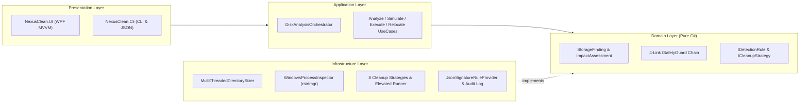

# NexusClean

> **Intelligent, Safety-First Windows Disk Audit, Cache Cleanup & Secondary-Drive Relocation System**  
> Designed with **4-Layer Clean Architecture (.NET 8 / C# 12)**, **SOLID Design Patterns**, and **GitHub Spec Kit** Spec-Driven Development.

---

## Why NexusClean?

Traditional Windows cleanup utilities either miss over **140+ GB** of hidden developer/app/system bloat inside `AppData`, `%USERPROFILE%\.dot-folders`, WSL2 virtual disks, and Volume Shadow Copies—or act as reckless "one-click wipers" that destroy browser login sessions, saved cookies, IDE extensions, and chat media.

Born from a real-world Windows `C:` (`274.52 GB`, `98%` full) forensic case study that safely reclaimed **+60 GB**, **NexusClean** enforces **5 Golden Safety Rules**:

1. **Hardcoded Root Protection (`RootSystemFolderGuard`)**: Unconditionally blocks direct deletion of `AppData\Local`, `AppData\Roaming`, `%USERPROFILE%`, `C:\Windows`, and `C:\Program Files`.
2. **100% Browser Profile Preservation (`BrowserProfilePreservationGuard`)**: Purges only transient cache subdirectories (`Cache\Cache_Data`, `Code Cache`, `GPUCache`, `Service Worker\CacheStorage`) across Chrome, Edge, Brave, and Cốc Cốc while keeping `Login Data`, `Cookies`, `Bookmarks`, `History`, `Preferences`, and `Extensions` 100% intact.
3. **5-Tier Vietnamese Impact Analysis**: Explains in plain Vietnamese what every item is, its risk score (`0–10`), side effects if cleaned, and guaranteed preserved assets *before* any action is taken.
4. **Relocate Over Blind Delete**: Guides continuously growing user data (`ZaloData\media`, `pagefile.sys`, active WSL2 `ext4.vhdx`) toward secondary volumes (`D:`) with a `+20%` capacity buffer check instead of destructive deletion.
5. **Process-Lock Awareness & Isolated Admin Queue**: Uses Windows Restart Manager (`rstrtmgr.dll`) to skip locked files gracefully and isolates privileged maintenance (`vssadmin` shadow storage cap, `wsl --manage --move`) into a parameterized UAC workflow with bounded JSONL audit logging.

---

## Architecture Overview

---

## Repository Structure

| Path | Description |
| :--- | :--- |
| [`docs/01-SESSION-CONTEXT-AND-CASE-STUDY.md`](./docs/01-SESSION-CONTEXT-AND-CASE-STUDY.md) | Real-world `C:` full-disk audit metrics, 4 disk-refill mechanisms, and 5 Golden Rules |
| [`docs/02-OOD-CLEAN-ARCHITECTURE-SPEC.md`](./docs/02-OOD-CLEAN-ARCHITECTURE-SPEC.md) | 4-Layer OOD Clean Architecture, SOLID patterns, UML Class Diagram & 5-Tier Impact Matrix |
| [`docs/03-SEED-SIGNATURE-RULES.json`](./docs/03-SEED-SIGNATURE-RULES.json) | Seed declarative JSON detection & safety rules |
| [`docs/04-DOCS-AUDIT-AND-GAP-ANALYSIS.md`](./docs/04-DOCS-AUDIT-AND-GAP-ANALYSIS.md) | Technical audit & cross-document gap analysis of `docs/01..03` |
| [`.specify/memory/constitution.md`](./.specify/memory/constitution.md) | Non-negotiable project governance & safety constitution (`v1.0.0`) |
| [`specs/001-intelligent-disk-cleanup/`](./specs/001-intelligent-disk-cleanup/) | Full GitHub Spec Kit artifacts (`spec.md`, `plan.md`, `research.md`, `data-model.md`, `contracts/`, `checklists/`, `quickstart.md`, `tasks.md`) |
| [`.agents/skills/`](./.agents/skills/) | Workspace GitHub Spec Kit skills integrated for Google Antigravity (`agy`) |

---

## Spec-Driven Development Workflow (GitHub Spec Kit)

This repository uses [GitHub Spec Kit](https://github.com/github/spec-kit) (`specify-cli` with Antigravity `agy` skills):

1. **Constitution** (`/speckit-constitution`) → [`.specify/memory/constitution.md`](./.specify/memory/constitution.md) *(Completed)*
2. **Specification** (`/speckit-specify`) → [`specs/001-intelligent-disk-cleanup/spec.md`](./specs/001-intelligent-disk-cleanup/spec.md) *(Completed)*
3. **Architecture & Plan** (`/speckit-plan`) → [`plan.md`](./specs/001-intelligent-disk-cleanup/plan.md), [`research.md`](./specs/001-intelligent-disk-cleanup/research.md), [`data-model.md`](./specs/001-intelligent-disk-cleanup/data-model.md), [`contracts/`](./specs/001-intelligent-disk-cleanup/contracts/) *(Completed)*
4. **Task Breakdown** (`/speckit-tasks`) → [`specs/001-intelligent-disk-cleanup/tasks.md`](./specs/001-intelligent-disk-cleanup/tasks.md) (`T001`–`T046`) *(Completed)*
5. **Consistency Analysis** (`/speckit-analyze`) → Verified 100% requirement coverage & 0 constitution violations *(Completed)*
6. **Implementation** (`/speckit-implement`) → Ready to execute Phase 1 (`T001`) through Phase 8 (`T046`).
