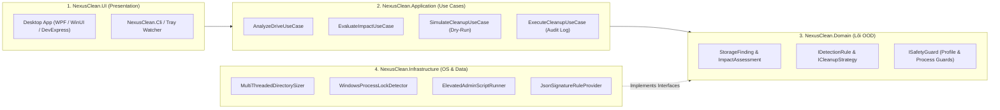
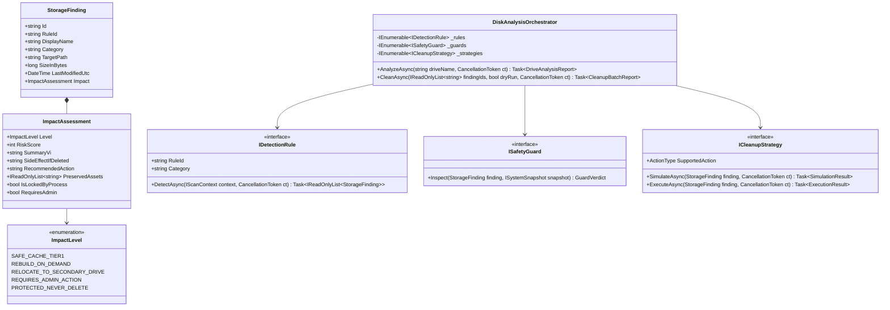

# Đặc Tả Kiến Trúc Hướng Đối Tượng (OOD & Clean Architecture) — Dự Án NexusClean

## 1. Mục Tiêu Kiến Trúc

**NexusClean** được thiết kế theo hướng **Lập trình Hướng đối tượng (OOP/OOD)** kết hợp **Clean Architecture 4 tầng** và các nguyên lý **SOLID**, đảm bảo:
- **Clean Code & Dễ bảo trì**: Mỗi lớp chỉ đảm nhiệm một trách nhiệm duy nhất (*Single Responsibility*).
- **Dễ mở rộng không sửa code lõi (*Open/Closed*)**: Bổ sung nhận diện ứng dụng mới chỉ bằng cách thêm 1 tệp cấu hình JSON hoặc 1 class `IDetectionRule` mới.
- **Tái sử dụng cao**: Tầng `NexusClean.Domain` và `NexusClean.Application` độc lập hoàn toàn với giao diện, dùng chung được cho cả **WPF / WinUI 3 / DevExpress Desktop**, **CLI**, hoặc **Background Tray Service**.
- **An toàn tuyệt đối nhờ Impact Analysis & Safety Guards**: Đánh giá mức độ ảnh hưởng 5 cấp độ và khóa cứng các thư mục chứa Profile người dùng trước mọi thao tác xóa.

---

## 2. Kiến Trúc Phân Tầng (4-Layer Clean Architecture)



---

## 3. Các Design Patterns Chủ Đạo

1. **Strategy Pattern (`IDetectionRule`, `ICleanupStrategy`)**:
   - Tách riêng thuật toán xử lý cho từng nhóm: `FullDirectoryDeleteStrategy` (bộ cài cũ), `SelectiveSubfolderPurgeStrategy` (chỉ xóa cache con trình duyệt, giữ nguyên Profile), `SemVerDuplicatePruneStrategy` (chỉ xóa bản cũ của extension VS Code/Postman, giữ bản mới nhất), `SecondaryDriveRelocateStrategy` (di dời dữ liệu sang ổ `D:`).
2. **Chain of Responsibility (`ISafetyGuard`)**:
   - Mọi `StorageFinding` trước khi thực thi đều đi qua chuỗi chốt chặn:
     `RootSystemFolderGuard` → `BrowserProfilePreservationGuard` → `RunningProcessLockGuard` → `AdminElevationGuard`.
   - Chỉ cần 1 chốt chặn trả về `Block`, thao tác xóa trực tiếp sẽ bị vô hiệu hóa ngay lập tức.
3. **Command + Dry-Run Pattern (`SimulateAsync` / `ExecuteAsync`)**:
   - Luôn cho phép tính toán dung lượng thu hồi dự kiến và xem báo cáo tác động trước khi thực sự chạm vào ổ đĩa.
4. **Observer Pattern (`IDiskGrowthWatcher`)**:
   - Theo dõi tốc độ tăng trưởng dung lượng các thư mục nóng (`%TEMP%`, `ZaloData`, `*-updater`) để cảnh báo chủ động.

---

## 4. Sơ Đồ Lớp Hướng Đối Tượng (UML Class Diagram)



---

## 5. Ma Trận 5 Cấp Độ Đánh Giá Tác Động (Impact Analysis Matrix)

| Cấp độ (`ImpactLevel`) | Điểm rủi ro | Chiến lược xử lý (`Strategy`) | Giải thích hiển thị trên UI |
| :--- | :---: | :--- | :--- |
| **`SAFE_CACHE_TIER1`** | `0 - 1` | `FullDirectoryDeleteStrategy` / `SemVerDuplicatePruneStrategy` | Xóa an toàn 100%. Bộ cài cũ, file tạm hoặc phiên bản trùng lặp dư thừa. |
| **`REBUILD_ON_DEMAND`** | `2 - 3` | `SelectiveSubfolderPurgeStrategy` | Xóa an toàn bộ nhớ đệm. Giữ nguyên 100% Profile, mật khẩu và cấu hình; ứng dụng tự tạo lại cache khi cần. |
| **`RELOCATE_TO_SECONDARY_DRIVE`** | `4 - 6` | `SecondaryDriveRelocateStrategy` | Chứa dữ liệu người dùng phình to liên tục (VD: Zalo Media). Khuyến nghị dời sang ổ `D:` thay vì xóa. |
| **`REQUIRES_ADMIN_ACTION`** | `5 - 7` | `ElevatedAdminScriptStrategy` | Tệp đang do dịch vụ hệ thống (`SYSTEM` / `WSLService` / `VSS`) quản lý. Cần thực thi với quyền Administrator. |
| **`PROTECTED_NEVER_DELETE`** | `10` *(Khóa)* | `BlockedNoOpStrategy` | Thư mục cốt lõi hoặc chứa thông tin đăng nhập/Profile. Khóa nút Xóa để bảo vệ máy. |

---

## 6. Cấu Trúc Solution Chuẩn (.NET 8+) Cho `NexusClean`

```text
NexusClean/
├── docs/
│   ├── 01-SESSION-CONTEXT-AND-CASE-STUDY.md
│   ├── 02-OOD-CLEAN-ARCHITECTURE-SPEC.md
│   └── 03-SEED-SIGNATURE-RULES.json
├── src/
│   ├── NexusClean.Domain/
│   │   ├── Entities/
│   │   │   ├── StorageFinding.cs
│   │   │   └── ImpactAssessment.cs
│   │   ├── Enums/
│   │   │   ├── ImpactLevel.cs
│   │   │   └── CleanupActionType.cs
│   │   ├── Interfaces/
│   │   │   ├── IDetectionRule.cs
│   │   │   ├── ISafetyGuard.cs
│   │   │   ├── ICleanupStrategy.cs
│   │   │   └── IDirectorySizer.cs
│   │   └── Guards/
│   │       ├── ProtectedBrowserProfileGuard.cs
│   │       ├── RootAppDataGuard.cs
│   │       └── RunningProcessLockGuard.cs
│   ├── NexusClean.Application/
│   │   ├── Orchestration/
│   │   │   └── DiskAnalysisOrchestrator.cs
│   │   ├── UseCases/
│   │   │   ├── AnalyzeDriveUseCase.cs
│   │   │   ├── SimulateCleanupUseCase.cs
│   │   │   └── ExecuteCleanupUseCase.cs
│   │   └── Rules/
│   │       ├── JsonSignatureDetectionRule.cs
│   │       ├── BrowserSelectiveCacheRule.cs
│   │       └── DuplicateVersionExtensionRule.cs
│   ├── NexusClean.Infrastructure/
│   │   ├── FileSystem/
│   │   │   └── MultiThreadedDirectorySizer.cs
│   │   ├── OS/
│   │   │   ├── WindowsProcessInspector.cs
│   │   │   └── VssShadowStorageManager.cs
│   │   └── Strategies/
│   │       ├── FullDirectoryDeleteStrategy.cs
│   │       ├── SelectiveSubfolderPurgeStrategy.cs
│   │       ├── SemVerDuplicatePruneStrategy.cs
│   │       └── SecondaryDriveRelocateStrategy.cs
│   └── NexusClean.UI/
│       └── (WPF / WinUI 3 / DevExpress / Blazor Hybrid)
└── tests/
    ├── NexusClean.Domain.Tests/
    └── NexusClean.Application.Tests/
```
