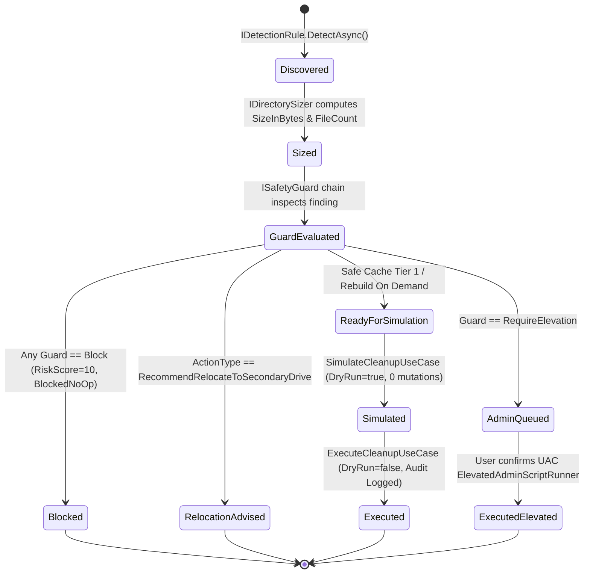

# Phase 1 Data Model: NexusClean Domain & Application Entities

**Feature**: `001-intelligent-disk-cleanup`  
**Date**: 2026-11-15  
**Architecture Layer**: `NexusClean.Domain` (pure C# entities/enums/value objects) & `NexusClean.Application` (DTOs/reports)

---

## 1. Enumerations (`NexusClean.Domain.Enums`)

### 1.1 `ImpactLevel`
| Value | Numeric Order | Allowed `RiskScore` Range | Default Pre-Selected? | Meaning |
| :--- | :---: | :---: | :---: | :--- |
| `SAFE_CACHE_TIER1` | `0` | `0..1` | Yes | 100% safe leftover installers, temp files, or superseded duplicate versions. |
| `REBUILD_ON_DEMAND` | `1` | `1..3` | Yes | Transient app/browser/package caches recreated automatically on demand; 100% profile/config preserved. |
| `RELOCATE_TO_SECONDARY_DRIVE` | `2` | `4..6` | **No** | Continuously growing user media/workspace data (`ZaloData\media`, `pagefile.sys`); relocate to `D:` instead of deleting. |
| `REQUIRES_ADMIN_ACTION` | `3` | `4..7` | **No** | OS/service-managed storage (`System Volume Information`, `WSL2 ext4.vhdx`); isolated UAC workflow required. |
| `PROTECTED_NEVER_DELETE` | `4` | `10` (Fixed) | **No (Locked)** | Root system/profile directory or credential asset; unconditionally blocked from deletion. |

### 1.2 `CleanupActionType`
| Value | Strategy Bound | Mutates User Filesystem? | Requires Elevation? |
| :--- | :--- | :---: | :---: |
| `DeleteContents` | `FullDirectoryDeleteStrategy` | Yes (contents only) | No |
| `DeleteUnlockedItems` | `DeleteUnlockedItemsStrategy` | Yes (unlocked children) | No |
| `SelectiveSubfolderPurge` | `SelectiveSubfolderPurgeStrategy` | Yes (allowlisted cache subdirs only) | No |
| `SemVerDuplicatePrune` | `SemVerDuplicatePruneStrategy` | Yes (old unreferenced versions & stale `.uuid` dirs) | No |
| `RecommendRelocateToSecondaryDrive` | `SecondaryDriveRelocateStrategy` | No (Advisory & pre-flight check) | No |
| `RelocateOrUnregisterAdmin` | `ElevatedAdminScriptStrategy` | Yes (via elevated `wsl --manage`) | **Yes** |
| `ResizeShadowStorageAdmin` | `ElevatedAdminScriptStrategy` | Yes (via elevated `vssadmin`) | **Yes** |
| `BlockedNoOp` | `BlockedNoOpStrategy` | **Never** | No |

### 1.3 `GuardSeverity`
- `Allow` (`0`): Safe to proceed with bound `CleanupActionType`.
- `Warn` (`1`): Proceed with warning badge (e.g., partial process lock detected; unlocked items can still be cleaned or queued).
- `RequireElevation` (`2`): Must route to `ElevatedMaintenanceQueue` rather than standard user-space batch.
- `Block` (`3`): Immediately override `Impact.Level = PROTECTED_NEVER_DELETE`, `Impact.RiskScore = 10`, and `ActionType = BlockedNoOp`.

---

## 2. Core Domain Entities & Value Objects (`NexusClean.Domain.Entities`)

### 2.1 `StorageFinding`
Represents a concrete, sized storage consumer discovered during a drive scan.

| Field | Type | Constraints / Invariants |
| :--- | :--- | :--- |
| `Id` | `string` | Required, deterministic SHA-256 short hash (`16` hex chars) of `(RuleId, NormalizedTargetPath)`. |
| `RuleId` | `string` | Required, non-empty, matches `^[a-z0-9_]+(\.[a-z0-9_]+){1,4}$`. |
| `DisplayName` | `string` | Required, non-empty, max length `160` chars. |
| `Category` | `string` | Required, non-empty, max length `64` chars. |
| `TargetPath` | `string` | Required, canonicalized absolute Windows path (`Path.GetFullPath`), no trailing slash except drive root. |
| `SubPathsToClean` | `IReadOnlyList<string>` | Required (empty for whole-folder strategies; explicit child paths for `SelectiveSubfolderPurge` and `SemVerDuplicatePrune`). Every entry MUST start with `TargetPath + "\"`. |
| `SizeInBytes` | `long` | Required, `>= 0`. |
| `FileCount` | `int` | Required, `>= 0`. |
| `LastModifiedUtc` | `DateTime` | Required, UTC kind. |
| `ActionType` | `CleanupActionType` | Required; forced to `BlockedNoOp` if `Impact.Level == PROTECTED_NEVER_DELETE`. |
| `Impact` | `ImpactAssessment` | Required, non-null value object. |
| `GuardVerdicts` | `IReadOnlyList<GuardVerdict>` | Audit trail of all `ISafetyGuard` inspections evaluated on this finding. |

### 2.2 `ImpactAssessment` (Value Object)
| Field | Type | Constraints / Invariants |
| :--- | :--- | :--- |
| `Level` | `ImpactLevel` | Required enum value. |
| `RiskScore` | `int` | Required, bounded `0 <= RiskScore <= 10`; MUST equal `10` when `Level == PROTECTED_NEVER_DELETE`. |
| `SummaryVi` | `string` | Required, non-empty Vietnamese explanation (min `10` chars). |
| `SideEffectIfDeleted` | `string` | Required, non-empty Vietnamese description of deletion consequences. |
| `RecommendedAction` | `string` | Optional/Required when `Level` is `RELOCATE_TO_SECONDARY_DRIVE` or `REQUIRES_ADMIN_ACTION`. |
| `PreservedAssets` | `IReadOnlyList<string>` | Required, at least 1 item for `SAFE_CACHE_TIER1` and `REBUILD_ON_DEMAND`. |
| `IsLockedByProcess` | `bool` | True if one or more files/handles are held by an active OS process. |
| `LockingProcesses` | `IReadOnlyList<string>` | Distinct process names holding locks (empty when `IsLockedByProcess == false`). |
| `RequiresAdmin` | `bool` | True if execution requires Windows Administrator token. |

### 2.3 `GuardVerdict` (Value Object)
| Field | Type | Constraints / Invariants |
| :--- | :--- | :--- |
| `GuardName` | `string` | Required (e.g., `RootSystemFolderGuard`, `BrowserProfilePreservationGuard`). |
| `Severity` | `GuardSeverity` | Required (`Allow`, `Warn`, `RequireElevation`, `Block`). |
| `ReasonCode` | `string` | Required machine-readable code (e.g., `PROTECTED_ROOT_PATH`, `CRITICAL_CREDENTIAL_FILE`, `PROCESS_LOCKED`). |
| `MessageVi` | `string` | Required human-readable Vietnamese explanation when `Severity != Allow`. |

### 2.4 `RelocationPlan` (Value Object)
Produced by `SecondaryDriveRelocateStrategy` for `RELOCATE_TO_SECONDARY_DRIVE` findings.

| Field | Type | Constraints / Invariants |
| :--- | :--- | :--- |
| `FindingId` | `string` | Required reference to `StorageFinding.Id`. |
| `SourcePath` | `string` | Required absolute path on system drive (`C:\...`). |
| `RecommendedTargetDrive` | `string?` | Nullable (null when machine has no secondary fixed drive). |
| `RecommendedTargetPath` | `string?` | E.g., `D:\ZaloData` or `D:\WSL`. |
| `RequiredBytesWithBuffer` | `long` | `ceil(SourceSizeInBytes * 1.20)`. |
| `AvailableTargetBytes` | `long` | Free bytes on `RecommendedTargetDrive` (`0` if none). |
| `HasSufficientSpace` | `bool` | `RecommendedTargetDrive != null && AvailableTargetBytes >= RequiredBytesWithBuffer`. |
| `StepByStepGuideVi` | `IReadOnlyList<string>` | Ordered Vietnamese instructions for safe migration. |

---

## 3. Declarative Rule & Report Models (`NexusClean.Application.Models`)

### 3.1 `SignatureCatalogDocument` & `SignatureRuleDefinition`
Maps `docs/03-SEED-SIGNATURE-RULES.json` and custom rule packs:
- `Version`: SemVer string (`^\d+\.\d+\.\d+$`).
- `ProtectedCriticalFileNames`: `IReadOnlyList<string>` (merged with hardcoded immutable baseline in `BrowserProfilePreservationGuard` so removing an entry from JSON can NEVER weaken Domain protection!).
- `ProtectedRootPaths`: `IReadOnlyList<string>` (merged with hardcoded immutable baseline in `RootSystemFolderGuard`).
- `Rules`: `IReadOnlyList<SignatureRuleDefinition>` where each rule validates that at least one of `TargetPaths`, `BasePaths` (with `ProfileFolderRegex` + non-empty `AllowedCacheSubfolders`), or `ExtensionRoot` is provided.

### 3.2 `DriveAnalysisReport`
- `ScanId` (`Guid`), `DriveName` (`string`, e.g., `"C:\\"`), `TotalCapacityBytes` (`long`), `FreeBytesBeforeScan` (`long`), `StartedAtUtc` (`DateTime`), `DurationMs` (`long`).
- `Findings` (`IReadOnlyList<StorageFinding>`).
- Computed aggregates: `SafeReclaimableBytes` (`SAFE_CACHE_TIER1` + `REBUILD_ON_DEMAND`), `RelocatableBytes` (`RELOCATE_TO_SECONDARY_DRIVE`), `AdminReclaimableBytes` (`REQUIRES_ADMIN_ACTION`).

### 3.3 `CleanupItemResult` & `CleanupBatchReport`
- `BatchId` (`Guid`), `IsDryRun` (`bool`), `ExecutedAtUtc` (`DateTime`), `IsElevatedBatch` (`bool`).
- `ItemResults`: per-finding `FindingId`, `RuleId`, `TargetPath`, `ActionExecuted`, `BytesReclaimed` (or projected in Dry-Run), `FilesDeletedCount`, `SkippedLockedPaths` (`IReadOnlyList<string>`), `Errors` (`IReadOnlyList<string>`), `Status` (`Succeeded`, `PartiallySucceeded`, `SkippedLocked`, `BlockedByGuard`, `Failed`).
- `TotalBytesReclaimed` (`long`), `TotalFilesProcessed` (`int`), `TotalSkippedLockedCount` (`int`).

### 3.4 `DiskGrowthAlert`
- `AlertId` (`Guid`), `ObservedAtUtc` (`DateTime`), `TargetPath` (`string`), `RuleId` (`string?`), `PreviousBytes` (`long`), `CurrentBytes` (`long`), `DeltaBytes` (`long`), `DriveFreeBytes` (`long`), `RecommendedActionVi` (`string`).

---

## 4. Finding Lifecycle & State Transitions

