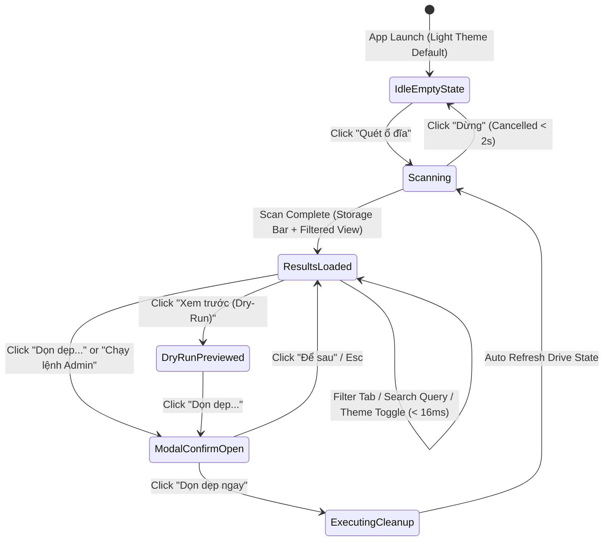

# Phase 1 Data Model (Presentation State): Native Windows 11 UI/UX Redesign

**Feature**: `002-native-win11-ui-redesign`  
**Layer Scope**: `NexusClean.UI` ONLY (`Domain`, `Application`, and `Infrastructure` entities remain 100% unchanged)

---

## 1. Presentation Enums (`NexusClean.UI.ViewModels`)

### `AppThemeMode`
- `Light` *(Default — Native Windows 11 Fluent Light)*
- `Dark` *(Neutral Graphite Dark — zero blue/neon cast)*

### `FindingFilterCategory`
- `All` — All discovered findings (`Tất cả mục`)
- `SafeCleanup` — `SAFE_CACHE_TIER1` + `REBUILD_ON_DEMAND` (`Dọn an toàn`)
- `Relocate` — `RELOCATE_TO_SECONDARY_DRIVE` (`Dời sang ổ phụ`)
- `AdminQueue` — `REQUIRES_ADMIN_ACTION` (`Bảo trì hệ thống`)

### `BadgeTone`
- `Safe` (`SAFE_CACHE_TIER1` — Subtle Green tint)
- `Rebuild` (`REBUILD_ON_DEMAND` — Subtle Windows Blue tint)
- `Relocate` (`RELOCATE_TO_SECONDARY_DRIVE` — Subtle Amber tint)
- `Admin` (`REQUIRES_ADMIN_ACTION` — Subtle Indigo/Slate tint)
- `Protected` (`PROTECTED_NEVER_DELETE` — Subtle Red/Locked tint)

---

## 2. ViewModel Entities & State Contracts

### `StorageBarBreakdownViewModel`
Represents proportional widths (`GridLength` star weights, minimum `0.001*` when `> 0` so visible slices render cleanly) for the unified Windows 11 Storage Bar:

| Property | Type | Calculation / Validation Rule |
| :--- | :--- | :--- |
| `DriveTitle` | `string` | e.g., `"Ổ đĩa hệ thống (C:)"` |
| `UsageHeadline` | `string` | e.g., `"Đã dùng 235,07 GB / 274,52 GB • Còn trống 39,45 GB"` |
| `OtherUsedRatio` | `GridLength` | `max(0, UsedBytes - SafeBytes - RelocateBytes - AdminBytes)` |
| `SafeReclaimableRatio` | `GridLength` | `Report.SafeReclaimableBytes` |
| `RelocatableRatio` | `GridLength` | `Report.RelocatableBytes` |
| `AdminQueueRatio` | `GridLength` | `Report.AdminReclaimableBytes` |
| `FreeSpaceRatio` | `GridLength` | `Report.FreeBytesBeforeScan` |
| `HasScanData` | `bool` | `true` once first scan completes; shows neutral placeholder track before scan |

---

### `FindingItemViewModel` (Enhanced Presentation Projection)
Wraps immutable `NexusClean.Domain.Entities.StorageFinding` without duplicating domain logic:

| Property | Type | Presentation Mapping |
| :--- | :--- | :--- |
| `Model` | `StorageFinding` | Underlying immutable Domain entity |
| `IsSelected` | `bool` | Editable only when `CanSelectForStandardCleanup == true` |
| `CanSelectForStandardCleanup` | `bool` | `SAFE_CACHE_TIER1` or `REBUILD_ON_DEMAND` and `!RequiresAdmin` |
| `CleanTitle` | `string` | Naturalized display title without redundant parenthetical suffixes |
| `CompactPath` | `string` | Normalized path shown as muted second line in table row |
| `FormattedSize` | `string` | Tabular formatted size (`4,71 GB`, `457,3 MB`, `4,0 KB`) |
| `RelativeSizePercent` | `double` | `0..100` (`SizeInBytes * 100.0 / MaxFindingBytesInScan`) for mini WizTree-style bar |
| `ShortBadgeText` | `string` | `"Xóa an toàn"`, `"Tự tạo lại"`, `"Nên dời ổ"`, `"Quyền Admin"`, `"Được bảo vệ"` |
| `BadgeTone` | `BadgeTone` | Maps `Impact.Level` to theme-aware subtle pill colors |
| `RiskLabel` | `string` | `"Thấp (0/10)"`, `"Thấp (2/10)"`, `"Trung bình (5/10)"`, `"Cao (10/10)"` |
| `IsLocked` | `bool` | `Model.Impact.IsLockedByProcess` |
| `LockSummaryText` | `string` | `"Không có tiến trình giữ khóa"` or `"Đang mở bởi: Chrome, Zalo..."` |

---

### `ConfirmationModalViewModel`
Replaces legacy Win32 `MessageBox.Show` with an inline Windows 11 `ContentDialog` overlay:

| Property | Type | Purpose |
| :--- | :--- | :--- |
| `IsOpen` | `bool` | Controls modal backdrop visibility |
| `Title` | `string` | Concise Vietnamese dialog title (e.g., `"Xác nhận dọn dẹp bộ nhớ đệm"`) |
| `PrimaryMessage` | `string` | Clear summary of items, predicted reclaimed space, and skipped open files |
| `HighlightBullets` | `IReadOnlyList<string>` | Key safety guarantees / parameterized command preview |
| `ConfirmButtonText` | `string` | e.g., `"Dọn dẹp ngay"` or `"Chạy với quyền Admin"` |
| `CancelButtonText` | `string` | `"Để sau"` |
| `IsDestructiveOrElevated` | `bool` | Switches primary button accent between Primary Blue and Caution Indigo |

---

## 3. UI State Transitions

