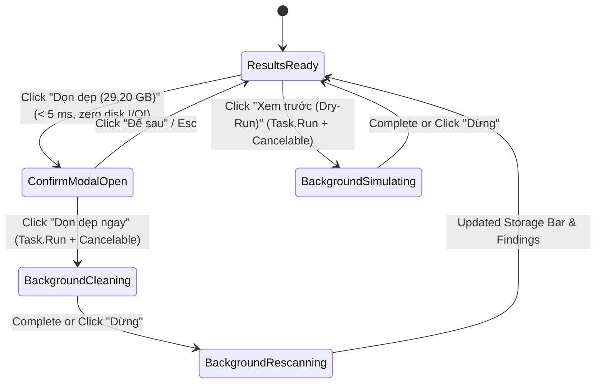

# Phase 1 Data Model: Non-Blocking Async Cleanup Engine

**Feature**: `003-async-nonblocking-cleanup-engine`

---

## 1. Domain Value Object (`NexusClean.Domain.Entities` / `Interfaces`)

### `CleanupProgress` (Pure C# Record in `NexusClean.Domain.Interfaces`)
 mirrors existing `ScanProgress` so both `NexusClean.UI` and `NexusClean.Cli` can stream real-time feedback during Dry-Run and Cleanup execution:

| Field | Type | Constraints & Purpose |
| :--- | :--- | :--- |
| `CurrentRuleId` | `string` | Active finding `RuleId` being simulated or cleaned |
| `CurrentDisplayName` | `string` | Human-readable finding name |
| `CompletedItems` | `int` | `0 <= CompletedItems <= TotalItems` |
| `TotalItems` | `int` | `TotalItems >= 1` |
| `CumulativeBytesProcessed` | `long` | Running total of simulated or deleted bytes (`>= 0`) |
| `CumulativeFilesProcessed` | `int` | Running total of simulated or deleted files (`>= 0`) |
| `CumulativeSkippedLocked` | `int` | Running total of locked/inaccessible files gracefully skipped (`>= 0`) |
| `IsDryRun` | `bool` | Distinguishes Dry-Run preview from live cleanup |

---

## 2. Updated Application & Strategy Signatures

### `DiskAnalysisOrchestrator.CleanAsync`
```csharp
public Task<CleanupBatchReport> CleanAsync(
    IReadOnlyList<StorageFinding> selectedFindings,
    bool dryRun,
    IProgress<CleanupProgress>? progress = null,
    CancellationToken cancellationToken = default)
```

### `SimulateCleanupUseCase.ExecuteAsync` & `ExecuteCleanupUseCase.ExecuteAsync`
- Wrap entire execution body inside `Task.Run(async () => { ... }, cancellationToken)` so calling from any UI `SynchronizationContext` returns an incomplete `Task` in `< 1 ms`.
- Emit `CleanupProgress` before and after each finding (and throttled every `250` files inside large multi-gigabyte directories via an internal progress callback).

---

## 3. UI Cleanup Lifecycle State Transitions (`MainDashboardViewModel`)


